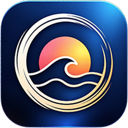
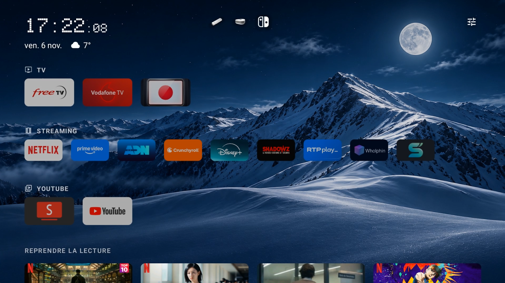
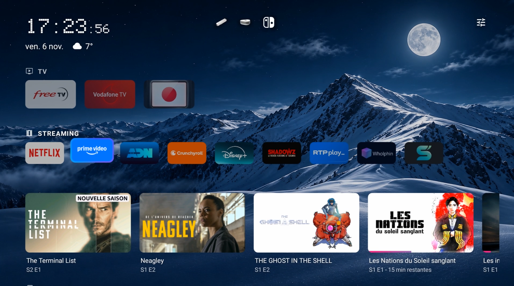
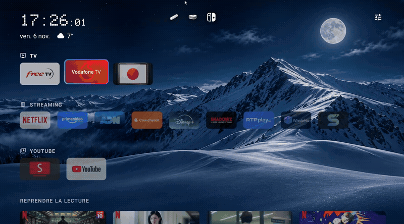

<p align="center">
  
</p>

<h1 align="center">Shizuka Launcher</h1>

<p align="center">
  <em>Sérénité, fluidité et élégance.</em> Un lanceur d'applications moderne, personnalisable et sans publicité pour Android TV et Google TV.
</p>

<p align="center">
  
  
  
  <a href="LICENSE"></a>
  <a href="https://github.com/fabarbosa54/Shizuka"></a>
</p>

---

## 📸 Aperçu & Démonstration

<p align="center">
  
  
</p>

### 🎬 Animation des tiroirs de flux en cascade
<p align="center">
  <a href="docs/vignettes.mp4">
    
  </a>
  <br>
  <em>Cliquez sur l'aperçu animé pour ouvrir la vidéo haute définition (<a href="docs/vignettes.mp4">vignettes.mp4</a>).</em>
</p>

---

## 🌟 À propos du projet (Origine & Fork)

**Shizuka Launcher** est un **fork indépendant** de l'excellent projet [Plume Launcher](https://github.com/aradhyas8/Plume_Launcher) créé par **aradhyas8**.

Alors que Plume met l'accent sur un minimalisme strict avec une seule ligne d'applications, **Shizuka** étend cette philosophie en offrant une expérience visuelle et ergonomique beaucoup plus riche et moderne pour les grands écrans TV :

* **Multi-lignes et catégories personnalisées** pour organiser les applications par thématiques (Streaming, TV, Jeux, Utilitaires...).
* **Lueurs de sélection dynamiques & personnalisables** (styles néon avec animations et réglage d'épaisseur).
* **Styles d'horloges contemporains** (Pixel 2 lignes, Apple TV moderne) avec météo épurée.
* **Profondeur & Relief 3D** avec ombres portées douces sur les tuiles en surbrillance.
* **Gestion avancée des entrées TV & appareils** (logos personnalisés Freebox Delta, PC, Nintendo Switch, Wii, etc.).
* **Mode Cadre photo automatique** après inactivité.

Le tout en conservant l'ADN initial : **0 dépendance superflue**, performance maximale, taille APK ultra-légère (~0.4 Mo), aucun tracker ni publicité.

---

## ✨ Fonctionnalités ajoutées dans Shizuka (v1.1.0)

### 🎬 0. Tiroirs de flux dynamiques par application (Nouveau en v1.1.0)
- Sélectionnez une application vidéo (**YouTube**, **SmartTube**, **Netflix**, **Prime Video**, **Disney+**, **Crunchyroll**, **ADN**, **Shadowz**, **RTP Play**, **OQEE by Free**) pour déployer automatiquement ses recommandations ou reprises de lecture sous la ligne, avec une **animation en cascade fluide**.
- **Sélecteur de canaux par application** accessible via un appui long sur l'icône (**Flux du tiroir**) ou depuis les paramètres.
- **Jauge de délai configurable** de **0.5 s à 3.0 s** avant l'ouverture du tiroir.
- **Mode veille plein écran** : l'horloge, la date et la météo s'agrandissent et glissent au centre de l'écran en mode cadre photo.

### 🌈 1. Lueurs de sélection néon personnalisées
Personnalisez le contour lumineux autour des tuiles sélectionnées avec un aperçu en temps réel :
- **8 palettes de couleurs :**
  - *Google Arc-en-ciel* (Bleu, rouge, jaune, vert style Gemini)
  - *Aurore boréale* (Vert émeraude, cyan & violet)
  - *Coucher de soleil* (Orange chaleureux, rose & violet)
  - *Océan* (Bleu profond, azur & turquoise)
  - *Feu* (Rouge flamboyant & ambre doré)
  - *Cyberpunk* (Rose néon & cyan électrique)
  - *Blanc pur* (Blanc givré doux & argenté)
  - *Couleur du fond d'écran* (Harmonisé automatiquement avec l'image)
- **3 modes d'animation :** Rotation fluide, Pulsation douce (respiration) ou Statique.
- **3 épaisseurs de lueur :** Subtile, Standard ou Marquée.

### 🗂️ 2. Gestion des catégories & Lignes d'applications
- Créez des lignes thématiques (Streaming, Vidéos, Jeux, etc.).
- Réorganisez ou déplacez vos applications facilement d'une ligne à l'autre via un appui long (**OK** maintenu).
- Choisissez d'afficher vos catégories **au-dessus** ou **en dessous** de la ligne *Reprendre la lecture* (*Continue Watching*).
- Masquez les titres de catégories si vous préférez une interface ultra-minimaliste.
- Réglage de l'espacement vertical entre les lignes (du très compact au spacieux).

### 🕰️ 3. Styles d'horloge & météo modernisés
- **Pixel empilée** : Heures et minutes sur deux lignes superposées imposantes et lisibles.
- **Apple TV moderne** : Typographie fine, date et météo harmonieuses.
- Styles originaux conservés : Fin, Gras, Serif.
- Icônes météo vectorielles adaptées au fond d'écran.

### 🎮 4. Gestion des sources & périphériques
- Support d'icônes dédiées dans la barre supérieure ou les lignes : **Freebox Delta**, **PC / Ordinateur**, **Nintendo Switch**, **Wii**, **PlayStation**, **Xbox**, **Apple TV**, **HDMI**.
- Possibilité d'épingler vos entrées directement parmi vos lignes d'applications.

### 🪟 5. Profondeur 3D & Esthétique
- Ombre portée matérielle douce et légère élévation 3D (`elevation` + `translationZ`) sur l'élément sélectionné pour une meilleure mise en valeur visuelle.
- Mode **Mise en valeur de la ligne active** : atténue subtilement les lignes non sélectionnées.
- Choix de l'arrondi des tuiles : Rectangulaire, Classique, Arrondi, Très arrondi, Pilule.
- Mode **Cadre photo automatique** : masque l'interface après inactivité (2, 5 ou 10 minutes) pour laisser place au fond d'écran ou aux scènes Aerial Views.

### 📱 6. Menu contextuel enrichi
- Appui long sur n'importe quelle application pour :
  - **Déplacer** (dans la ligne)
  - **Changer de catégorie**
  - **Masquer l'application**
  - **Infos sur l'application**
  - **Désinstaller**

---

## 📥 Installation

Compatible avec **Android TV** et **Google TV** (Android 8.0 et supérieur).

1. Téléchargez l'APK depuis la page [Releases](https://github.com/fabarbosa54/Shizuka/releases).
2. Transférez-le sur votre téléviseur (via clé USB, application **Downloader**, ou `adb`) :
   ```sh
   adb install -r Shizuka.apk
   ```
3. Définissez **Shizuka** comme lanceur d'accueil par défaut dans les paramètres Android TV.

---

## 🛠️ Compilation depuis les sources

```sh
git clone https://github.com/fabarbosa54/Shizuka.git
cd Shizuka
./gradlew assembleDebug
```

L'APK généré sera disponible dans `app/build/outputs/apk/debug/app-debug.apk`.

---

## 👥 Remerciements & Crédits

- **Projet source initial :** [Plume Launcher](https://github.com/aradhyas8/Plume_Launcher) par **aradhyas8**.
- **Scènes Aerial Views :** projet [Aerial Views](https://github.com/theothernt/AerialViews) (licence GPL-3.0) & NASA Earth Observatory.
- **Logos des applications :** [Simple Icons](https://simpleicons.org) (CC0).
- **Icônes système :** [Material Symbols](https://fonts.google.com/icons) par Google (Apache 2.0).

---

## 📜 Licence

Shizuka Launcher est un logiciel libre distribué sous la licence **[GNU General Public License v3.0](LICENSE)**, en conformité avec la licence du projet d'origine Plume Launcher.
